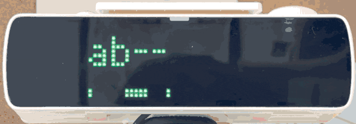

# agentbar

Shows coding-agent session state on a BUSY Bar. v1 ships a Claude Code adapter;
the core is harness-agnostic.



## Features

- **One tile per Claude Code session**, up to three, on the bar's front display.
  The rest of the display stays free for other apps.
- **Four states at a glance**, told apart by colour and motion, not colour
  alone:
  - needs input: amber, blinking
  - working: green, a segment bouncing along the bar
  - done: a solid, still green bar
  - idle: dim steel blue
- **Subagents** each get a small square on their session's tile. It spins
  while the agent works, blinks amber when the agent needs you, and pulses
  once when the agent finishes.
- **Readable labels:** the initials of the session name (`claude --name` or
  `/rename`), or of the project folder.
- **Only sessions you're using:** a session appears after its first prompt.
  Claude Code's spare background processes stay off the bar.
- **Steps aside for the BUSY timer** and comes back when it ends.
- **Hands-off:** runs as a launchd agent and adds Claude Code hooks without
  touching your other hooks.
- **`agentbar demo`** shows it all off; `agentbar screen` captures what the
  bar is showing.

## Install (macOS)

You need macOS, a BUSY Bar connected over USB (Wi-Fi works too, see
[Config](#config)), [Claude Code](https://code.claude.com), and
[uv](https://docs.astral.sh/uv/) with Python 3.11 or later.

```sh
uv tool install /path/to/agentbar     # or: uv tool install --editable .
agentbar install                      # hooks in ~/.claude/settings.json + launchd agent
agentbar status                       # sessions the daemon is tracking
```

`install` backs up `~/.claude/settings.json` before editing it, and leaves hooks
that aren't agentbar's untouched. Re-running it is safe. Hooks take effect in new
Claude Code sessions.

Logs: `~/Library/Logs/agentbar.log`.

Remove everything: `agentbar uninstall`.

## Demo

The GIF at the top shows `agentbar demo` on a bar. The demo plays scripted
sessions through the running daemon, so you see the real layout and
animations, in two scenes of about 16 s each:

| Scene | What it shows |
| --- | --- |
| `states` | One session goes through every state: working (bouncing segment) → needs input (amber blink) → done (solid green) → idle (steel blue). Then three sessions side by side |
| `agents` | A session starts three subagents, each a spinning square. One needs input, so its square and the label blink amber. The main turn finishes while the agents keep working, and each agent's square pulses once as it finishes |

While the demo plays, your real sessions are hidden. They keep being tracked
and come back as soon as the demo ends or you press Ctrl-C. The terminal prints
a caption for each step, so you can talk over it.

```sh
agentbar demo                    # both scenes, about 32 s
agentbar demo --scene agents     # one scene; repeat --scene to pick several
agentbar demo --loop             # repeat until Ctrl-C
agentbar screen --frames 4       # what the bar shows right now, captured 4 times
```

## Reading the bar

The front display gets a fixed region of `max_tiles` tiles, right-aligned by
default. The columns to its left (16 px wide by default) are the
[plugin](#plugin) area. Each tile shows:

- a 4-character label;
- a row of 2×2 squares, one per running subagent, in that agent's state colour
  (up to 6);
- a 2px bar in the session's state colour underneath, touching the squares.

The label takes the most active state of the session and its subagents. A
session that is done while a background agent works shows a green label and
square over a still green bar. A subagent at a permission prompt turns its square
and the label amber and blinking, whatever the session itself is doing.

The label is the initials of the session's name, set with `claude --name` or
`/rename`. Unnamed sessions use the project folder (cwd basename) instead.
Words are split on `-`, `_`, spaces and case changes, and missing characters
are filled with `-`:

| Name | Label |
| --- | --- |
| `busy-agent-bar` | `bab-` |
| `istari-rfc-equivalency` | `ire-` |
| `mcpTenancy` | `mt--` |
| `agentbar` | `a---` |
| `one-two-three-four-five` | `ottf` |

Sessions with the same label get a digit in place of the last character:
`bab1`, `bab2`.

Labels use the bar's `condensed` font (7 px tall, most letters 4 px wide), which
fills the tile: `bab-` is exactly 18 px. Four full-width letters with no `-`, `i`,
`j`, `l` or `r` (such as `abcd`, or a duplicate like `bab1`) are 1 px wider, and
`m`, `v`, `w`, `x` add another pixel each; the bar clips the overflow at the tile
edge. Rows 0–1 stay blank above the label. Descenders (`g j p q y`) reach row 10,
leaving one blank row above the squares instead of three.

| State | Colour | Behaviour |
| --- | --- | --- |
| needs input | amber | blinks (bright/dim, 1 Hz) |
| working | green | a segment bounces between the bar's end caps (every 6 s); working agents' squares spin a bright pixel clockwise |
| done | green, still and solid | becomes idle after 1 hour |
| idle | steel-blue label, dim steel-blue bar | |

Working and done share green: working moves, done is a full, still bar. Red is
left out on purpose: the bar's own BUSY focus timer is red. See
`CLAUDE.md` for the reasons behind each colour.

A session gets a tile only once it does something: a prompt, a tool call or a
subagent. Claude Code also starts sessions nobody is using (spare background
processes, untouched background sessions), and those stay off the bar.
`agentbar status` lists them as hidden.

If there are more sessions than tiles, higher-priority states win a tile
(needs input > working > done > idle), counting each session's subagents.
Tiles stay in first-seen order. Squares follow the same rule within a tile.

While a native BUSY timer session is running, the bar refuses lower-priority
drawings with `409`. The daemon then clears its tiles and retries every 5 s,
redrawing once the session ends.

## Config

`~/.config/agentbar/config.toml`. Every key is optional; defaults shown.

```toml
[busybar]
host = "10.0.4.20"          # USB. For Wi-Fi: the bar's LAN IP plus `token`
# token = "1234"
application_name = "agentbar"
priority = 50

[layout]
# x = 0                     # left edge of the region; omit to right-align
tile_width = 18
gap = 1
max_tiles = 3
name_chars = 4              # label length
font = "condensed"          # tiny, small, normal, condensed, bold, ...
text_y = 0
bar_height = 2
agent_size = 2              # subagent squares, on top of the bar
agent_gap = 1
show_idle = true
dim_factor = 0.2            # blink "off" brightness for needs input
shimmer = true              # animate working sessions and agents
shimmer_width = 5           # width of the bouncing segment
shimmer_factor = 0.6        # brightness of a working agent's square behind its pixel

[layout.colors]
working = "#00C850"
needs_input = "#FFC000"
done = "#00C850"
idle = "#385868"

[layout.text_colors]        # label colour, where it differs from the bar
idle = "#6090A8"

[timing]
done_decay_s = 3600
session_ttl_s = 7200        # only for sessions whose process couldn't be found
blink_period_s = 1.0
shimmer_step_s = 1.0        # seconds per animation frame (6 per bounce, 4 per spin)
busy_retry_s = 5.0
refresh_s = 60.0
```

### Project icons

Give a project a small pixel icon instead of its 4-character label. Draw it with
`#` (lit) and `.` (off), at most 18 wide and 8 tall:

```toml
[projects."~/src/twack/busy-agent-bar"]
icon = """
....##....
..######..
.#..##..#.
.########.
..#....#..
...####...
"""
```

The icon applies to sessions started in that folder or any folder under it. If
several entries match, the deepest folder wins. It's drawn in the session's state
colour, like the label, so it still blinks amber when the session needs you.
Restart the daemon after editing the config: `launchctl kickstart -k
gui/$(id -u)/com.agentbar.daemon`.

### Plugin

One plugin draws in the columns left of the tiles: a 16×16 px area with the default
layout. Two are built in, chosen with `builtin`:

| `builtin` | Shows |
| --- | --- |
| `clock` (default) | The time in grey, and a line along the bottom that fills as the hour passes. Updates as each minute starts. |
| `tokens` | Today's Claude Code tokens, all sessions and subagents together, such as `5.8M`. It counts input, output and prompt-cache writes and reads, so it runs high. Updates every `interval_s`. |

```toml
[plugin]
builtin = "tokens"
```

`tokens` reads Claude Code's session transcripts in `~/.claude/projects`, counting
each message once (Claude Code repeats a message's usage across several transcript
entries, and copies messages into forked sessions). After the first pass it reads
only what was added since.

To show something else, give a command. agentbar runs it every `interval_s` seconds
and draws what it prints in place of the built-in:

```toml
[plugin]
command = "/Users/you/bin/bar-weather"   # run with /bin/sh -c
interval_s = 30                          # at least 1
timeout_s = 5
```

To turn the plugin area off, set `enabled = false` under `[plugin]`.

The command prints either **one line of text** (shown in the `small` font, white,
from the left edge) or **JSON** with up to 20 elements, in coordinates inside the
area (x 0–15, y 0–15):

```json
{"elements": [
  {"type": "text", "x": 0, "y": 3, "text": "10:20", "font": "small", "color": "#909090"},
  {"type": "rectangle", "x": 0, "y": 14, "width": 6, "height": 1, "fill_colors": ["#385868"]},
  {"type": "xpmbitmap", "x": 12, "y": 0, "data": "! XPM2\n2 2 2 1\n. c none\n# c #FFC000\n#.\n.#\n"}
]}
```

- Element types: `text` (`text`, `font`, `color`, `width`), `rectangle` (`width`,
  `height`, `fill`, `fill_colors`, `border_width`, `border_color`, `radius`) and
  `xpmbitmap` (inline XPM2 pixel art in `data`, up to 32 colours, `c none` for
  transparent). Text and rectangles are clipped to the area. Other fields are
  ignored, and agentbar sets the ids itself.
- If the command fails, times out or prints something unusable, the area shows a
  small amber `!` and `agentbar status` shows the error. The next good run
  replaces it.
- The daemon runs under launchd, where `PATH` is only
  `/usr/bin:/bin:/usr/sbin:/sbin`, so use absolute paths.
- `examples/clock.sh` is the built-in clock written as a command plugin, a
  starting point for your own.

The bar shows one application at a time. While the plugin is on, agentbar always
has something on screen, so the bar's own home screen doesn't appear. Set
`enabled = false` to get it back when no session has a tile.

## Development

### How it works

```
Claude Code hooks ──> agentbar-hook ──(unix socket)──> agentbar daemon ──(HTTP)──> BUSY Bar
                      stdlib-only,                     adapter → registry
                      always exit 0                    → layout → sink
```

### Claude Code state mapping

See `src/agentbar/adapters/claude_code.py`. In short:

- `UserPromptSubmit`, `PreToolUse`, `PostToolUse` → working
- `PermissionRequest`, `AskUserQuestion`, `Notification` (permission prompt) → needs input
- `Stop` → done
- `SessionEnd` → removed
- `SubagentStart` / `SubagentStop` → subagent square added / removed

Hooks fired inside a subagent carry `agent_id`. They change that subagent's
square, not the session, so a background agent doesn't flip a finished session
back to working. A `Stop` with no background tasks in flight clears any
leftover squares.

`idle_prompt` notifications are ignored, so a finished session stays "done"
instead of switching to "needs input".

Session names: `SessionStart` and `UserPromptSubmit` carry `session_title` when
the session has a custom name. A `/rename` shows on the tile after the next
prompt.

Liveness: on `SessionStart` and `UserPromptSubmit`, the forwarder records the
Claude Code PID (nearest non-shell ancestor, found with one `ps` call). The
daemon drops the session when that process exits. Long-running tools therefore
don't expire.

### Running without a bar

Stop the launchd agent first, or set `AGENTBAR_SOCKET` to another path:

```sh
agentbar run --dry-run -v
```

### Verify on the device

These are assumptions the code makes that couldn't be checked without a bar:

1. Re-posting an element with an existing `id` replaces it rather than adding
   a duplicate. Watch for flicker or ghosting when a tile changes state.
2. During a BUSY session, draws fail with 409 and the tiles reappear afterwards.
3. If `Stop` doesn't fire when you interrupt Claude with Esc, the tile stays
   "working" until the next prompt.

### Adding a harness

1. Add `adapters/<name>.py` with `SOURCE` and
   `normalize(payload, ts, pid) -> AgentEvent | None`.
2. Register it in `adapters/__init__.py`.
3. Point the harness's hooks at `agentbar-hook <SOURCE>`. Pass
   `--resolve-pid` on infrequent events.

The forwarder sends only top-level scalar fields of the hook payload.

### Tests and lint

```sh
uv run pytest
uv run ruff format     # format
uv run ruff check      # lint
```
